# H2ToGo
# Manual de Usuario — Plataforma H2ToGo

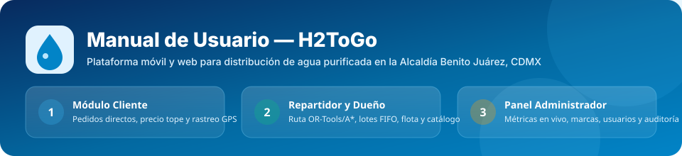

> [!NOTE]
> **Acerca de H2ToGo**
> **H2ToGo** es una plataforma integral (aplicación móvil multiplataforma para **Android** e **iOS** + **Panel Web Administrativo**) diseñada para gestionar el pedido, asignación, ruteo, seguimiento e inventario por lotes de agua purificada embotellada en garrafones de 20 L dentro de la **Alcaldía Benito Juárez, Ciudad de México**.

---

## Índice General

1. [Requisitos del Sistema y Perfiles de Usuario](#1-requisitos-del-sistema-y-perfiles-de-usuario)
2. [Acceso, Registro y Seguridad de la Cuenta](#2-acceso-registro-y-seguridad-de-la-cuenta)
3. [Manual del Cliente](#3-manual-del-cliente)
   - [3.1 Pantalla de Inicio y Exploración de Purificadoras](#31-pantalla-de-inicio-y-exploración-de-purificadoras)
   - [3.2 Gestión de Direcciones de Entrega](#32-gestión-de-direcciones-de-entrega)
   - [3.3 Cómo Realizar un Pedido (Directo, Precio Máximo y Programado)](#33-cómo-realizar-un-pedido-directo-precio-máximo-y-programado)
   - [3.4 Seguimiento de Pedido en Tiempo Real y Mapa Interactivo](#34-seguimiento-de-pedido-en-tiempo-real-y-mapa-interactivo)
   - [3.5 Recepción y Cancelación de Pedidos](#35-recepción-y-cancelación-de-pedidos)
   - [3.6 Historial y Repetición de Pedidos](#36-historial-y-repetición-de-pedidos)
   - [3.7 Política de Ausencias y Suspensión Temporal](#37-política-de-ausencias-y-suspensión-temporal)
4. [Manual del Repartidor y Dueño de Purificadora](#4-manual-del-repartidor-y-dueño-de-purificadora)
   - [4.1 Inicio de Jornada, Selección de Vehículo y Estado Operativo](#41-inicio-de-jornada-selección-de-vehículo-y-estado-operativo)
   - [4.2 Bandeja de Pedidos Disponibles y Agenda de Programados](#42-bandeja-de-pedidos-disponibles-y-agenda-de-programados)
   - [4.3 Ruta del Día (OR-Tools + A*) y Navegación en Vivo](#43-ruta-del-día-or-tools--a-y-navegación-en-vivo)
   - [4.4 Proceso de Entrega en Domicilio (Completa, Parcial, En Sitio y No Entregado)](#44-proceso-de-entrega-en-domicilio-completa-parcial-en-sitio-y-no-entregado)
   - [4.5 Gestión de Inventario Base (FIFO), Carga de Vehículo y Mermas](#45-gestión-de-inventario-base-fifo-carga-de-vehículo-y-mermas)
   - [4.6 Gestión de Flota de Vehículos (Dueño)](#46-gestión-de-flota-de-vehículos-dueño)
   - [4.7 Catálogo de Productos y Precios (Dueño)](#47-catálogo-de-productos-y-precios-dueño)
   - [4.8 Administración del Negocio, Horarios y Equipo de Trabajo (Dueño)](#48-administración-del-negocio-horarios-y-equipo-de-trabajo-dueño)
5. [Manual del Administrador (Panel Web)](#5-manual-del-administrador-panel-web)
6. [Situaciones Especiales y Solución de Problemas (FAQ)](#6-situaciones-especiales-y-solución-de-problemas-faq)

---

## 1. Requisitos del Sistema y Perfiles de Usuario

| Componente | Especificación |
| :--- | :--- |
| **Sistema Operativo Móvil** | **Android 8.0+** o **iOS 15.0+** |
| **Panel Web Administrativo** | Navegador moderno (Chrome, Edge, Safari o Firefox) |
| **Conectividad** | Wi-Fi o red celular 4G/5G (con soporte de reconexión automática ante cortes de señal) |
| **Ubicación (GPS)** | **Opcional** para clientes (selector manual en mapa) · **Obligatorio** para repartidores en ruta |
| **Zona de Cobertura** | Colonias dentro del polígono oficial de la **Alcaldía Benito Juárez, CDMX** (validado con PostGIS) |

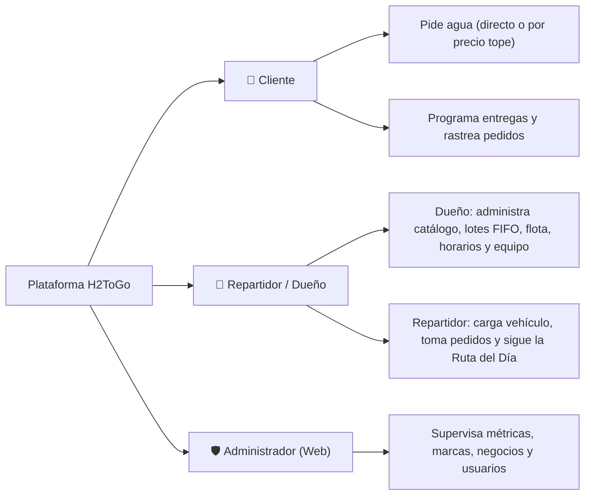

---

## 2. Acceso, Registro y Seguridad de la Cuenta

### 2.1 Registro de nueva cuenta
1. En la pantalla de bienvenida, pulsa **"Crear cuenta"**.
2. Selecciona tu perfil:
   - **Cliente**: Ingresa nombre(s), apellidos, correo electrónico, teléfono celular (10 dígitos) y contraseña (mínimo 8 caracteres, incluyendo mayúscula, minúscula y número).
   - **Repartidor / Purificadora**: Además de tus datos personales, elige una de las dos modalidades:
     - **Registrar una nueva purificadora (Dueño)**: Ingresa el nombre comercial del negocio y su dirección base (quedarás registrado como titular con acceso total).
     - **Unirme a una purificadora existente (Repartidor empleado)**: Selecciona la purificadora de la lista. Tu cuenta quedará en espera de que el **dueño de esa purificadora** te apruebe desde su perfil.

### 2.2 Verificación de teléfono por SMS (OTP)
1. Tras registrarte, recibirás un **código de 6 dígitos por SMS** (vigencia de 2 minutos).
2. Ingresa el código en la pantalla de verificación para activar tu cuenta.
3. Si escribiste mal tu número telefónico al registrarte, pulsa **"Cambiar número de teléfono"** en esa misma pantalla para corregirlo y recibir un nuevo código.

### 2.3 Inicio de sesión y recuperación de contraseña
- **Iniciar sesión**: Ingresa tu correo electrónico y contraseña. La sesión permanece activa automáticamente y se renueva mientras uses la aplicación (expira únicamente tras 30 días continuos de inactividad).
- **¿Olvidaste tu contraseña?**:
  1. Pulsa **"¿Olvidaste tu contraseña?"** en la pantalla de login.
  2. Ingresa tu correo registrado para recibir un código de recuperación por SMS.
  3. Introduce el código recibido y define tu nueva contraseña.

### 2.4 Ajustes de cuenta y Eliminación de cuenta (`Perfil`)

| Vista de Perfil y Direcciones | Opciones disponibles en `Perfil` |
| :---: | :--- |
| 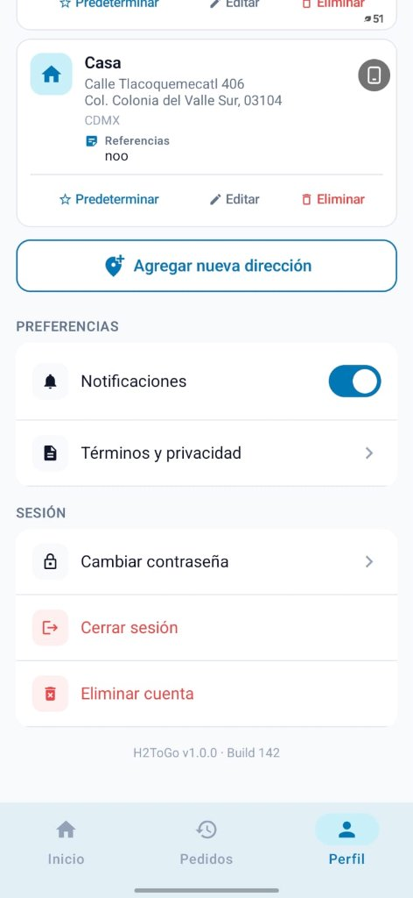 | • **Mis direcciones**: Agregar, editar, eliminar o marcar domicilio predeterminado (`☆ Predeterminar`).<br/>• **Notificaciones**: Interruptor para activar/desactivar alertas push.<br/>• **Términos y privacidad**: Consulta de políticas de uso.<br/>• **Cambiar contraseña**: Actualización con validación de contraseña actual.<br/>• **Cerrar sesión**: Cierra la sesión activa en el dispositivo.<br/>• **Eliminar cuenta**: Baja definitiva previa confirmación de contraseña (valida que no existan pedidos activos ni repartidores dependientes). |

---

## 3. Manual del Cliente

### 3.1 Pantalla de Inicio y Exploración de Purificadoras

| Pantalla Principal del Cliente (`Inicio`) | Funcionalidades clave |
| :---: | :--- |
| 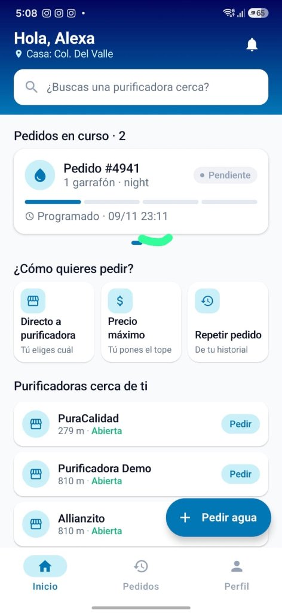 | **1. Selector de dirección superior**: Muestra el alias y colonia de tu dirección activa. Tócalo para cambiar de domicilio.<br/><br/>**2. Carrusel de `Pedidos en curso`**: Muestra el folio (`#ID`), estado actual, barra de avance y **tiempo/distancia estimada** (o la fecha y hora programada en horario CDMX).<br/><br/>**3. Acciones rápidas (`¿Cómo quieres pedir?`)**:<br/>• *Directo a purificadora*<br/>• *Precio máximo*<br/>• *Repetir pedido*<br/><br/>**4. Purificadoras cerca de ti**: Ordenadas por distancia en metros/kilómetros, indicando si están **Abiertas** o **Cerradas** según su horario del día. |

---

### 3.2 Gestión de Direcciones de Entrega
Desde **Perfil → Mis direcciones** (o desde el selector superior de Inicio):
1. Pulsa **"Agregar nueva dirección"**.
2. Asigna un **Alias** (ej. *Casa*, *Oficina*, *Departamento*) y escribe la **Calle**, **Número exterior**, **Número interior (opcional)**, **Colonia**, **Código Postal** y **Referencias** (ej. *Portón negro, tocar timbre 3*).
3. **Ubicación en el mapa interactivo**:
   - Conforme escribes tu dirección, el mapa posiciona automáticamente el pin.
   - También puedes pulsar **"Ubicar en mapa"** o **arrastrar el pin manualmente** sobre el mapa (puedes alternar entre vista **OSM** y **Google Maps**); al soltar el pin, el sistema detecta y rellena automáticamente la calle, colonia y código postal.
4. **Validación de cobertura**:
   - Al guardar, el sistema verifica mediante georreferenciación que el punto esté dentro de la **Alcaldía Benito Juárez**. Si está fuera de cobertura, te lo indicará de inmediato.

---

### 3.3 Cómo Realizar un Pedido (Directo, Precio Máximo y Programado)

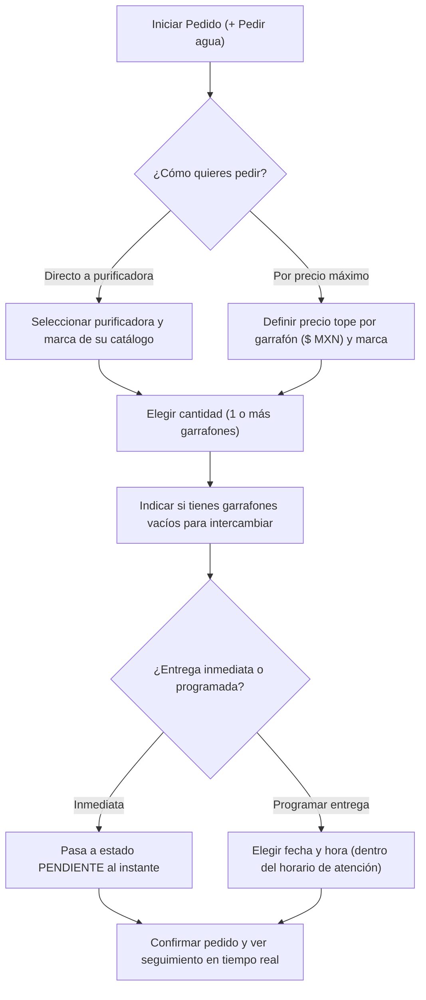

| Pedido Directo y Entrega Programada | Pedido Abierto con Precio Máximo | Edición Directa del Tope de Precio |
| :---: | :---: | :---: |
| 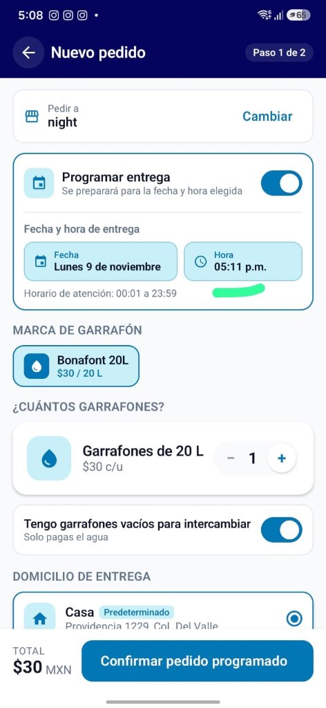 | 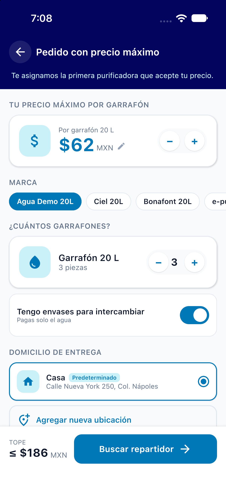 | 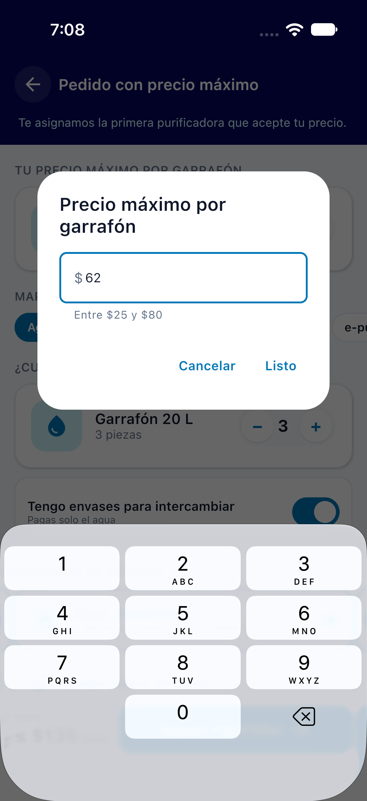 |
| Permite elegir purificadora, marca, cantidad, intercambio de envases y activar **Programar entrega** dentro del horario del negocio. | El cliente fija cuánto desea pagar por garrafón con los botones `− / +` o tocando el monto para escribirlo directamente. | Teclado numérico rápido para definir el precio máximo por garrafón (entre \$20 y \$120 MXN). |

---

### 3.4 Seguimiento de Pedido en Tiempo Real y Mapa Interactivo


Al tocar tu pedido activo se abre la pantalla **Tu pedido `#ID`**, donde puedes seguir cada etapa en vivo:

| 1. Buscando Repartidor (`Pendiente`) | 2. Repartidor en Camino (`En ruta`) | 3. Aviso de Llegada en Domicilio | 4. Panel de Recepción Activo |
| :---: | :---: | :---: | :---: |
| 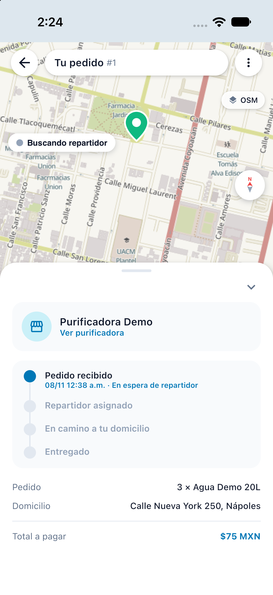 | 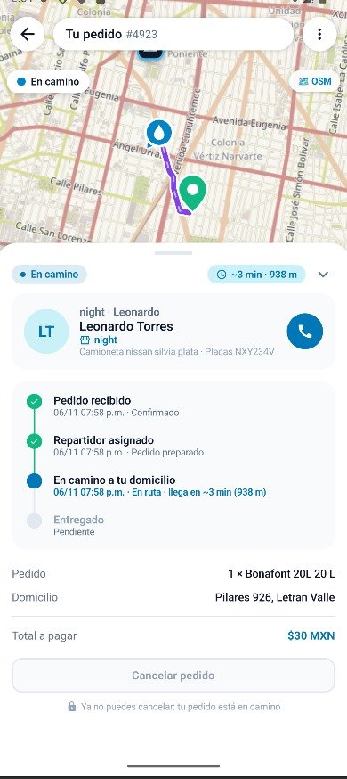 | 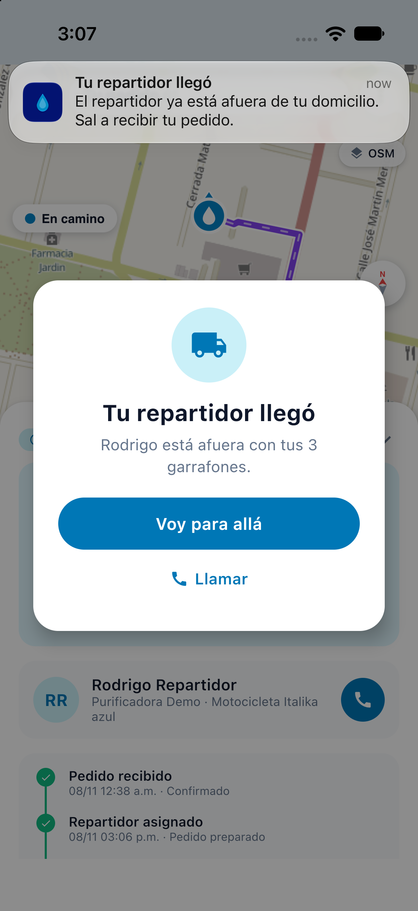 | 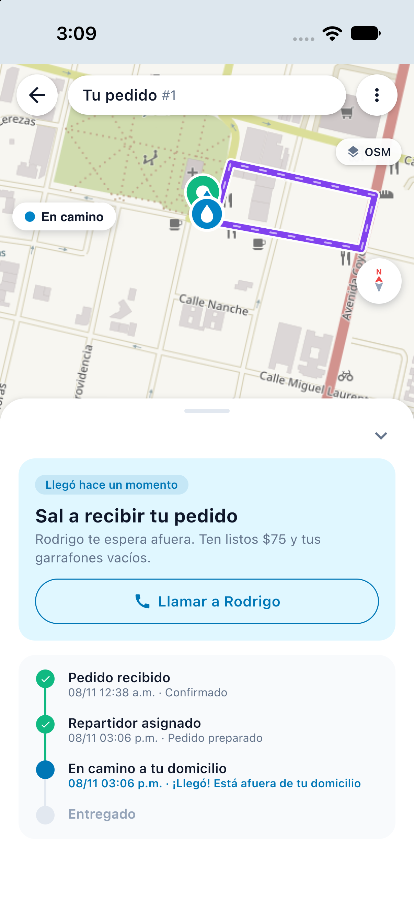 |
| Muestra el pin de tu domicilio y los detalles del pedido mientras se asigna un repartidor. | Traza la ruta vial `A*`, muestra el pin del repartidor en movimiento, ETA (`~3 min · 938 m`) y botón de llamada (`📞`). | Alerta emergente e instantánea cuando el repartidor pulsa *"Llegué al destino"* a ≤ 30 m de tu puerta. | Al cerrar la alerta, el panel inferior destaca **"Sal a recibir tu pedido"** con el monto exacto a preparar. |

---

### 3.5 Recepción y Cancelación de Pedidos
- **Aviso de proximidad y llegada**:
  - Cuando el repartidor se acerca a menos de **500 m**, recibes una notificación de proximidad.
  - Cuando llega a tu domicilio (≤ 30 m), recibes la alerta **"Tu repartidor llegó"** y cuentas con **10 minutos de tolerancia** para salir a recibirlo.
- **Cancelación de pedido**:
  - Puedes cancelar tu pedido sin penalización pulsando **"Cancelar pedido"** en la parte inferior del seguimiento **únicamente mientras ningún repartidor lo haya aceptado** (`Pendiente` o `Pendiente programado`).
  - Una vez aceptado o en camino, el botón se deshabilita indicando: *"🔒 Ya no puedes cancelar; tu pedido está en camino"*.

---

### 3.6 Historial y Repetición de Pedidos
En la pestaña **Pedidos**:
- Consulta todos tus pedidos anteriores ordenados del más reciente al más antiguo, con su estado final (*Entregado*, *Cancelado*, *No entregado*), fecha, purificadora, cantidad de garrafones y monto pagado.
- Pulsa **"Repetir pedido"** en cualquier entrega previa para volver a solicitar la misma configuración en un paso.

---

### 3.7 Política de Ausencias y Suspensión Temporal
> [!WARNING]
> **Regla de Ausencias Consecutivas (RN-006)**
> - Cuando el repartidor llega a tu domicilio, se activa un tiempo de tolerancia de **10 minutos**.
> - Si transcurren los 10 minutos sin que nadie reciba el pedido, el repartidor puede marcarlo como **No entregado (Cliente ausente)** y tu contador de ausencias suma `+1`.
> - Si acumulas **2 ausencias consecutivas**, tu cuenta quedará **suspendida temporalmente durante 3 días (72 horas)** para realizar nuevos pedidos.
> - Recibir un pedido exitosamente reinicia tu contador de ausencias a `0`.

---

## 4. Manual del Repartidor y Dueño de Purificadora

### 4.1 Inicio de Jornada, Selección de Vehículo y Estado Operativo
1. En la pestaña **Inicio** (o desde **Mi negocio → Vehículo**), para recibir pedidos debes ponerte **En línea (En turno)**.
2. **Seleccionar vehículo para la jornada**:
   - Elige cuál de los vehículos activos del negocio conducirás hoy (un vehículo solo puede ser utilizado por un repartidor a la vez).
   - Opcionalmente, en el mismo diálogo puedes indicar cuántos garrafones cargas inicialmente desde el almacén base.
3. **Finalizar jornada / Desconectarse**:
   - Al cambiar tu interruptor a **Desconectado (Fuera de línea)** o pulsar *Finalizar jornada*, el sistema devuelve automáticamente al almacén base todos los garrafones no apartados que quedaban en el vehículo y libera el vehículo para otro compañero.

---

### 4.2 Bandeja de Pedidos Disponibles y Agenda de Programados
En la pestaña **Inicio** del repartidor encontrarás:
1. **Pedidos inmediatos disponibles**:
   - Muestra los pedidos entrantes compatibles con tu negocio y con el stock disponible (en tu vehículo o en la base de tu purificadora).
   - Cada tarjeta indica folio, colonia/dirección, distancia, cantidad y marca de garrafones, si requiere envase nuevo y monto total.
   - Pulsa **"Aceptar pedido"** para asignártelo. El sistema aparta automáticamente los garrafones necesarios siguiendo el orden **FIFO** (primero del vehículo; si falta, los aparta en la base).
2. **Agenda de Pedidos Programados**:
   - Muestra los pedidos programados para el día que tu purificadora puede surtir.
   - Puedes pulsar **"Reservar"** para comprometerte a atender ese pedido programado (apartando el stock desde ese momento) o **"Liberar"** si ya no podrás cubrirlo antes de su hora.
   - Cuando llega la ventana previa a la hora programada, el sistema activa el pedido y te notifica para salir a entregarlo.

---

### 4.3 Ruta del Día (OR-Tools + A*) y Navegación en Vivo
Cuando tienes uno o varios pedidos asignados (`Asignado` o `En camino`), puedes abrir la pantalla de **Ruta de Entrega**:
1. **Optimización Multi-Parada (Ruta del Día)**:
   - Si llevas varios pedidos activos, el motor de optimización (**Google OR-Tools VRPTW** combinado con el grafo vial **A\*** de la Alcaldía Benito Juárez) calcula automáticamente la **secuencia óptima de paradas (`Parada 1, Parada 2, Parada 3...`)** respetando la capacidad del vehículo y las ventanas de horario de los pedidos programados.
   - En el mapa, cada tramo entre paradas se pinta de un color distinto (`verde`, `morado`, `naranja`, `azul`, etc.) coincidiendo con el número de cada marcador de parada.
2. **Carga pendiente desde la base**:
   - Si aceptaste un pedido cuyos garrafones quedaron apartados en el almacén de la purificadora porque no los llevabas arriba del vehículo, la pantalla te mostrará un aviso con el botón **"Cargar garrafones apartados al vehículo"** antes de iniciar el trayecto.
3. **Herramientas de navegación en el mapa**:
   - **Seguimiento automático de cámara**: El mapa sigue tu posición GPS en tiempo real.
   - **Brújula (`N`)**: Toca la brújula para alternar entre **Norte arriba** y **Modo Navegación (Rumbo arriba)**, donde el mapa gira automáticamente en la dirección en que conduces.
   - **Botón `◎ Centrar`**: Vuelve a centrar la cámara en tu vehículo después de mover el mapa con el dedo.
   - **Selector `OSM` / `Google Maps`**: Cambia el estilo visual del mapa en cualquier momento.
   - **Abrir en navegador externo**: Botones rápidos para enviar las coordenadas exactas del cliente a **Google Maps** o **Waze**.

---

### 4.4 Proceso de Entrega en Domicilio (Completa, Parcial, En Sitio y No Entregado)

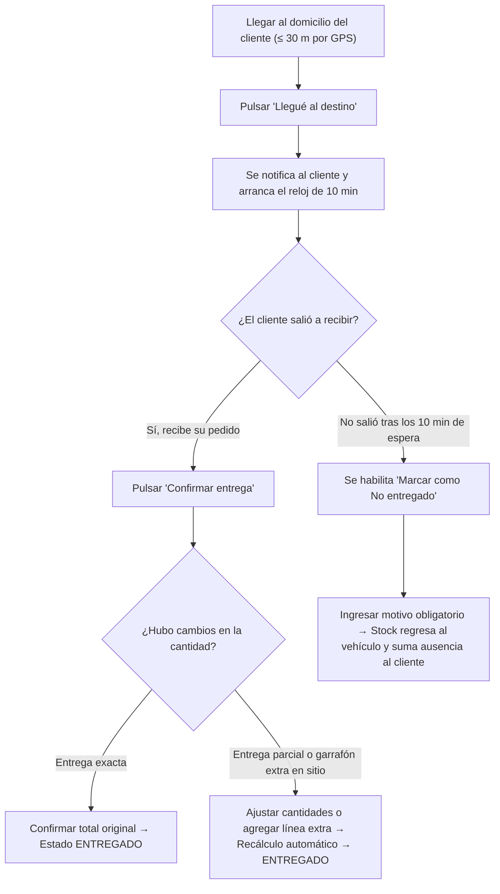

1. **Paso 1 — Avisar llegada ("Llegué al destino")**:
   - Al estar a **30 metros o menos** del domicilio del cliente, pulsa **"Llegué al destino"**.
   - El cliente recibe la alerta en su teléfono y en tu pantalla inicia la cuenta regresiva de **10:00 minutos** (el temporizador se guarda en memoria, por lo que no se pierde aunque salgas de la pantalla y regreses).
2. **Paso 2A — Confirmar Entrega (`Entregado`)**:
   - Pulsa **"Confirmar entrega"**. En el modal puedes:
     - **Confirmar entrega completa**: Si entregaste exactamente los garrafones solicitados.
     - **Registrar entrega parcial (RN-032)**: Si el cliente recibió menos garrafones de los pedidos, reduce la cantidad entregada; los garrafones no entregados se liberan automáticamente de vuelta al stock disponible de tu vehículo y el total a cobrar se recalcula al instante.
     - **Agregar garrafones adicionales en sitio**: Si el cliente te pide garrafones extra al momento de estar en su puerta, puedes agregarlos en el mismo modal siempre que tengas **stock libre (no apartado para otros pedidos)** en tu vehículo.
3. **Paso 2B — Marcar como `No entregado` (Cliente ausente)**:
   - El botón **"No entregado"** permanece bloqueado mientras corre el reloj de 10 minutos para garantizar el tiempo de espera al cliente.
   - Cuando el contador llega a `00:00`, el botón se habilita: selecciona o escribe el **motivo de no entrega** y confirma. Los garrafones apartados quedan liberados de inmediato en tu vehículo.

---

### 4.5 Gestión de Inventario Base (FIFO), Carga de Vehículo y Mermas

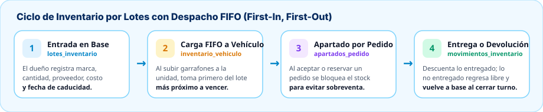

| 1. Inventario en Base (`En base`) | 2. Inventario a Bordo (`En mi vehículo`) | 3. Diálogo de Carga Rápida al Vehículo |
| :---: | :---: | :---: |
| 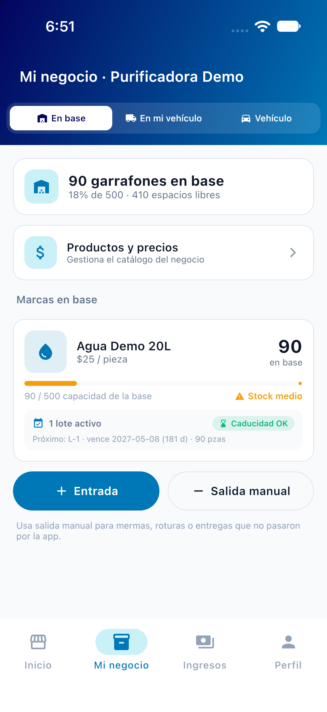 | 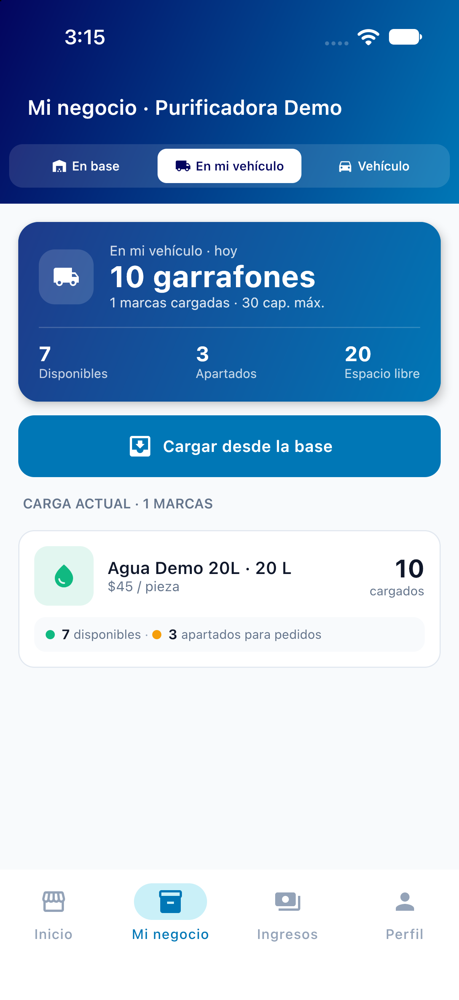 | 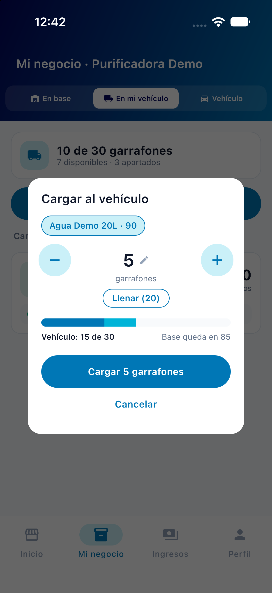 |
| Muestra capacidad total ocupada en base, estado de caducidad por lote (`Caducidad OK`), botón **`+ Entrada`** para nuevos lotes y **`− Salida manual`** para mermas o roturas. | Desglosa garrafones **Disponibles**, **Apartados para pedidos** y **Espacio libre** restante en la unidad, con botón directo para cargar más desde la base. | Permite elegir marca, ajustar piezas con `− / +`, tocar el número para editarlo o pulsar **`Llenar`** para completar la capacidad libre del vehículo en un toque. |

---

### 4.6 Gestión de Flota de Vehículos (Dueño)

| Gestión de Vehículos (`Vehículo`) | Reglas y capacidades de unidades |
| :---: | :--- |
| 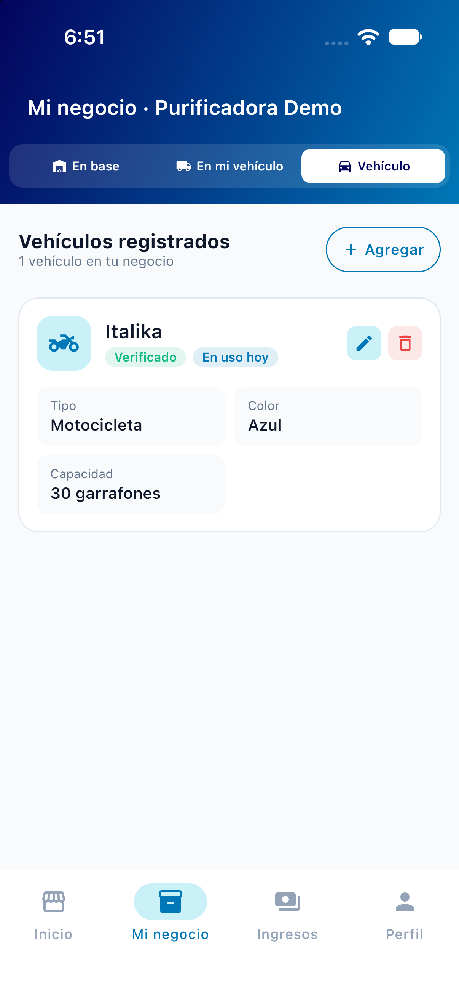 | • **Aplicación inmediata sin esperar autorización del admin**: Toda alta, modificación o baja de vehículos se refleja al instante en el negocio.<br/>• **Agregar vehículo (`+ Agregar`)**: Soporta *Motocicleta*, *Camioneta*, *Automóvil*, *Bicicleta de carga* y *Triciclo de carga* (las bicicletas y triciclos no requieren placas ni marca/modelo, únicamente color y capacidad).<br/>• **Editar (`✎`) y Dar de baja (`🗑`)**: Actualiza datos o desactiva unidades de forma inmediata. |

---

### 4.7 Catálogo de Productos y Precios (Dueño)
Desde **Mi negocio → Productos y precios** (o desde **Perfil**):
1. **Cambiar precio de agua (Aplicación inmediata)**:
   - Toca el botón **Editar precio** en cualquiera de tus productos activos, ingresa el nuevo precio del líquido (rango permitido: **\$20 a \$120 MXN**) y confirma. Los clientes verán el nuevo precio al instante.
2. **Agregar nuevo producto al catálogo (Aplicación inmediata)**:
   - Pulsa **"Agregar producto al catálogo"**.
   - Elige una de las marcas registradas en la plataforma, define el **Precio del agua**, el **Precio del envase** y la **Capacidad máxima de almacenamiento en tu base**, y pulsa **"Agregar producto"**.
   - La marca queda activa de inmediato en tu catálogo para que puedas registrar lotes y venderla.

---

### 4.8 Administración del Negocio, Horarios y Equipo de Trabajo (Dueño)
En la pestaña **Perfil** del dueño de la purificadora tienes control directo e inmediato sobre la configuración de tu negocio:
1. **Nombre comercial de la purificadora**:
   - Toca el ícono de edición junto al nombre de tu negocio, escribe el nuevo nombre comercial y pulsa **"Guardar cambio"**. Se actualiza al instante.
2. **Dirección y ubicación de la base**:
   - Toca **Cambiar dirección de la base**, ingresa calle, número, colonia, código postal y referencias, o ajusta el pin directamente en el mapa interactivo, y pulsa **"Guardar dirección"**. La nueva ubicación base se aplica de inmediato como punto de partida para las rutas de tus repartidores.
3. **Horario de atención semanal**:
   - Pulsa **Configurar horario**, define para cada día de la semana (Lunes a Domingo) si el negocio está **Abierto** (con hora de apertura y hora de cierre) o **Cerrado**, y guarda. Se aplica al instante.
4. **Gestión de Repartidores del Negocio (`Equipo`)**:
   - Cuando un repartidor se registra eligiendo unirse a tu purificadora, aparece en tu sección **Solicitudes de repartidores**.
   - Pulsa **Aprobar** para permitirle iniciar jornada en tu negocio o **Rechazar** para denegar el acceso.

---

## 5. Manual del Administrador (Panel Web)

El **Administrador del Sistema** accede mediante el Panel Web (`/admin/`) con credenciales de rol `admin`:

1. **Dashboard General**:
   - Visualización de indicadores clave en tiempo real: total de usuarios por rol, purificadoras activas, pedidos del día desglosados por estado (`pendiente`, `asignado`, `en_camino`, `entregado`, `no_entregado`, `cancelado`) e ingresos transaccionados.
2. **Gestión de Usuarios**:
   - Búsqueda y filtrado de cuentas de clientes, repartidores y administradores.
   - Creación de cuentas administrativas o de soporte.
   - **Baja administrativa de cuentas**: Permite desactivar cuentas por incumplimiento de normas con motivo registrado, invalidando su sesión de forma inmediata.
3. **Catálogo Global de Marcas**:
   - Alta de nuevas marcas oficiales de garrafones en la plataforma y activación/desactivación de marcas existentes.
4. **Supervisión de Purificadoras, Pedidos y Bitácora de Cambios**:
   - Consulta detallada de todas las purificadoras registradas, su flota y su catálogo.
   - Monitoreo global de pedidos con su historial completo de transiciones de estado.
   - Consulta del historial de altas, bajas y modificaciones realizadas por las purificadoras.

---

## 6. Situaciones Especiales y Solución de Problemas (FAQ)

| Situación | ¿Qué hace el sistema automáticamente? | ¿Qué debe hacer el usuario? |
| :--- | :--- | :--- |
| **El repartidor se queda sin internet a mitad de una entrega** | Muestra la franja *"Sin conexión · se muestra la última información conocida"*. El GPS y el mapa siguen guiando al repartidor. Si llega al domicilio y pulsa *"Llegué al destino"*, el reloj de 10 min arranca localmente y se sincroniza solo cada 4.5 s en cuanto regresa la red. | Continuar el recorrido normalmente; al recuperar señal móvil o Wi-Fi antes de cerrar la entrega, la app sincronizará sola la posición y el estado con el servidor. |
| **El cliente se queda sin internet mientras espera su pedido** | Conserva en pantalla los datos del repartidor, la ruta y la última posición conocida sin cerrar la vista. En cuanto vuelve la red, el WebSocket y el ciclo de respaldo (cada 4 s) actualizan el mapa al instante. | Mantener la pantalla abierta o reconectarse a Wi-Fi/datos móviles; la actualización se reanudará sola sin recargar manualmente. |
| **El repartidor apaga su GPS o quita permisos de ubicación** | No permite iniciar jornada sin permiso de ubicación. Si lo apaga en ruta, muestra un banner con acceso directo a *Activar ubicación / Ajustes*, usa temporalmente la ubicación de la base para el trazo vial y **bloquea el cierre de la entrega** si no valida estar a ≤ 30 m por GPS real. | Pulsar **"Activar ubicación"** en el aviso de la pantalla y encender el GPS del teléfono para poder registrar la llegada y entregar el pedido. |
| **El mapa tarda en cargar una zona por red móvil lenta** | El visor cuenta con respaldo multicapa automático: si un cuadro de OpenStreetMap tarda o falla, reintenta automáticamente en servidores CDN alternos y además permite cambiar con un toque al mapa de **Google Maps**. | Tocar el botón **`OSM / Google Maps`** en la esquina superior derecha del mapa para alternar de proveedor cartográfico, o pulsar **`◎ Centrar`**. |
```
