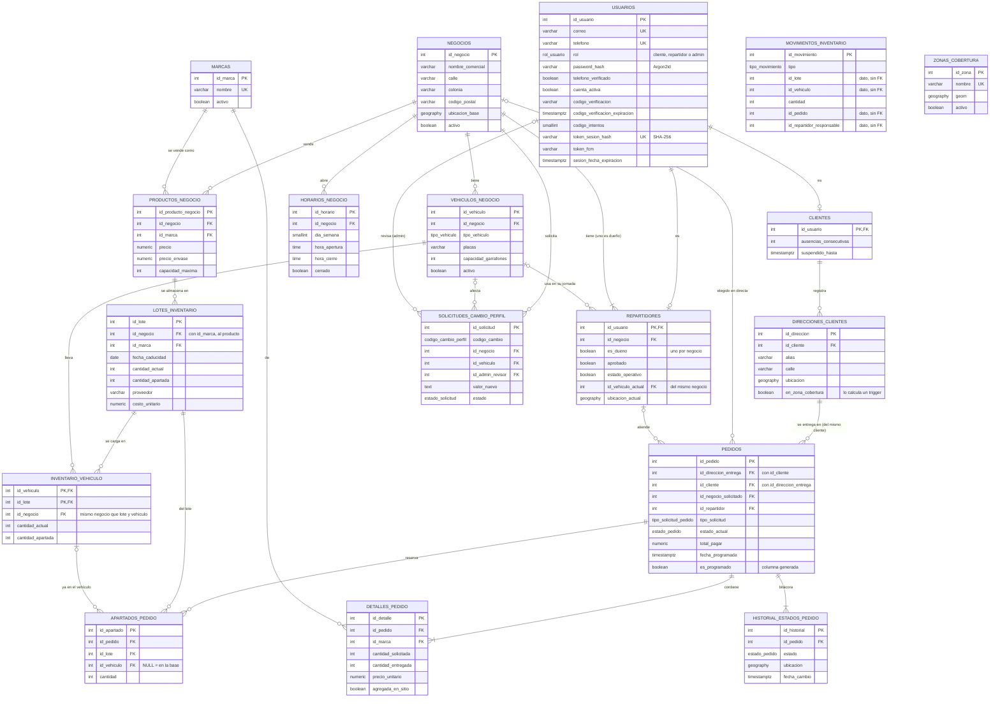

# Base de datos H2ToGo v7

Auditoría y reestructura del esquema (2026-10-26). El esquema completo está en
[`H2ToGo_v7_postgresql.sql`](../H2ToGo_v7_postgresql.sql). La migración que lleva una base v6 a v7
sin perder datos está en [`2026-10-26_v7.sql`](../h2togo-backend/sql/migraciones/2026-10-26_v7.sql).
Las pruebas manuales están en [`pruebas_v7.sql`](../pruebas_v7.sql) y las automáticas en
`ModeloDatosIT` y `SeguridadBdIT`.

La app funciona igual (con los cambios de comportamiento de la sección 5). Las 111 pruebas del backend pasan.

## Resumen

| | v6 | v7 |
|---|---|---|
| Tablas | 19 | 18 |
| Llaves foráneas | 34 | 24 |
| Ciclos entre tablas | 1 (negocios ↔ repartidores) | 0 |
| FKs diferibles | 2 | 0 |
| Arcos exclusivos ("esta columna O esta otra") | 2 | 0 |
| Verificaciones (CHECK) | 11 | 33 |
| Índices propios | 22 | 23 (6 parciales) |
| Roles de BD por actor | 0 | 5 |
| Políticas de seguridad por filas | 0 | 60 |
| Bitácoras protegidas contra cambios | 0 | 2 |

## 1. Qué se eliminó

| Elemento | Por qué |
|---|---|
| `negocios.id_dueno` y su FK | Formaba un ciclo con `repartidores.id_negocio`, que obligaba a usar FKs diferibles. Además no garantizaba que el dueño fuera miembro de su propio negocio. |
| Las 2 FKs diferibles | Ya no hay ciclo que resolver. |
| `apartados_pedido.id_lote_base` / `id_inventario_vehiculo` | Arco exclusivo: una de las dos columnas siempre iba vacía. |
| `movimientos_inventario.id_lote_base` / `id_inventario_vehiculo` | Mismo arco. En los traspasos el lote quedaba guardado dos veces y podía no coincidir. |
| `movimientos_inventario.proveedor` y `costo_unitario` | Duplicaban datos del lote. |
| `inventario_vehiculo.id_inventario_vehiculo` | Id sustituto innecesario: la llave natural es (vehículo, lote). |
| `inventario_vehiculo.activo` | Nunca se ponía en FALSE. Si hay o no garrafones ya lo dice `cantidad_actual`. |
| `solicitudes_cambio_perfil.id_producto_negocio` y su FK | Ningún tipo de cambio lo usaba. |
| `ON DELETE CASCADE` del historial | Borrar un pedido borraba su historial, y RN-013 pide que el historial sea inmutable. |
| Índices `idx_horarios_negocio` y `idx_clientes_suspendido` | El primero repetía el índice de `UNIQUE (id_negocio, dia_semana)`. El segundo no lo usaba ninguna consulta. |
| **[R6]** FK `pedidos.id_cliente → clientes` | Redundante: la FK compuesta `(id_direccion_entrega, id_cliente) → direcciones_clientes` ya obliga a que el cliente exista, porque cada dirección apunta a su cliente. La columna se queda. |
| **[R7]** FKs `lotes → negocios` y `lotes → marcas` | Se reemplazan por una sola, `(id_negocio, id_marca) → productos_negocio`. Además gana una regla: un negocio solo puede almacenar marcas que vende. |
| **[R8]** Las 4 FKs de `movimientos_inventario` | Es una bitácora: guarda los ids como datos de lo que pasó. Se escribe en la misma transacción que mueve las existencias, que sí están protegidas, y nunca cambia. |
| **[R9]** La tabla `administradores` | No tenía atributos. Su única función era que `id_admin_revisor` solo pudiera ser un admin; ahora lo garantizan los permisos: ningún rol salvo `h2togo_admin` puede modificar solicitudes. `id_admin_revisor` apunta a `usuarios`. |
| **[R10]** `pedidos.id_vehiculo_utilizado` | El vehículo con que se entregó cada pedido ya queda en su movimiento `salida_pedido`. |
| Backend: entidades `ApartadoPedido` y `Administrador`, `InventarioVehiculoRepository`, `MovimientoInventarioRepository`, `AdministradorRepository` | Código sin uso o de tablas eliminadas. |

## 2. Qué se modificó

- **[R1] Dueño del negocio.** Ahora es `repartidores.es_dueno`, con tres reglas:
  - un índice único parcial permite **a lo más un** dueño por negocio;
  - un trigger diferido exige al confirmar **al menos uno**;
  - un CHECK impide que el dueño esté pendiente de aprobación.

  En el backend, `Negocio.idDueno` sigue existiendo como dato de solo lectura (`@Formula`).
- **[R2] Inventario.** Los apartados y los movimientos guardan siempre `id_lote` y, cuando hay un vehículo de por medio, `id_vehiculo`. La FK compuesta `(id_vehiculo, id_lote)` apunta a `inventario_vehiculo`. Cargar al vehículo un garrafón apartado en la base ahora solo llena `id_vehiculo`.
- **[R3] `inventario_vehiculo`.** Lleva `id_negocio` con dos FKs compuestas: el lote y el vehículo deben ser del mismo negocio. En v6 se podía cargar un lote de la purificadora A en un vehículo de la B.
- **[R4] Solicitudes.** El vehículo de una solicitud debe ser del negocio que la hace (FK compuesta).
- **[R7] Lotes.** Apuntan al producto del negocio (negocio + marca) y no a negocio y marca por separado.
- **[R5] Bitácoras.** `historial_estados_pedido` y `movimientos_inventario` tienen un trigger que rechaza UPDATE y DELETE, aunque los intente el dueño de la BD. Esto cierra RN-013.
- **[C1]** `pedidos.es_programado` es una columna generada (`fecha_programada IS NOT NULL`), así que ya no puede contradecir a la fecha.
- **[C4]** `usuarios.token_sesion` pasa a `token_sesion_hash`, que guarda el SHA-256 del token. Si se filtra un respaldo de la BD, los tokens no sirven para entrar. La migración convierte las sesiones abiertas, así que nadie pierde la suya.
- **[C5]** `usuarios.codigo_intentos`: el código SMS se invalida al quinto intento fallido. Sin este límite, un código de 6 dígitos se podía adivinar probando, y con eso cambiar una contraseña desde "¿Olvidaste tu contraseña?".

## 3. Verificaciones nuevas (CHECK)

- **Cantidades:** cantidades y precios no negativos, y capacidad de vehículos y productos mayor que 0.
- **Inventario:** lo apartado nunca supera lo que hay, ni en la base (`lotes_inventario`) ni en el vehículo (`inventario_vehiculo`).
- **Horarios:** en un día abierto, la apertura es antes del cierre.
- **Pedidos:**
  - uno directo lleva negocio y no lleva precio máximo; uno abierto, al revés;
  - un programado lleva fecha;
  - de "asignado" en adelante tiene repartidor y vehículo;
  - solo los pedidos cerrados en el domicilio tienen fecha de entrega.
- **Detalles:** una línea con cantidad 0 solo existe si se agregó en sitio.
- **Solicitudes:**
  - una pendiente no tiene revisor ni fecha de resolución;
  - una resuelta tiene ambos;
  - los cambios de vehículo indican el vehículo.
- **Usuarios:**
  - la sesión se abre y se cierra completa (token y fechas juntos);
  - el código SMS siempre lleva su vencimiento;
  - el hash del token tiene formato de SHA-256.
- **Repartidores:** la ubicación siempre lleva la hora en que se reportó.

## 4. Errores que encontró la auditoría (corregidos)

1. **Liberar apartados descontaba de menos.** Si un pedido tenía dos líneas de la misma marca, había dos apartados del mismo lote y `UPDATE ... FROM` solo restaba uno. Ahora se suma por lote dentro de `fn_liberar_apartados`.
2. **El fin de jornada dejaba apartados mayores que la existencia.** La devolución regresaba todo a la base, incluidos los garrafones apartados para pedidos que seguían asignados. Ahora regresa solo lo libre.
3. **Una línea agregada en sitio podía tomar garrafones de otros pedidos.** Descontaba de la existencia total y no de la libre.
4. **Un lote que caducaba con garrafones apartados quedaba en existencia 0 con apartado mayor que 0.** Ahora la merma es solo de lo libre.
5. **El perfil público de una purificadora mostraba sus vehículos con placas.** Ahora solo los ve la propia purificadora.
6. v6 permitía:
   - un dueño que pertenecía a otro negocio;
   - un lote cargado en el vehículo de otro negocio;
   - una solicitud con el vehículo de otro negocio.

## 5. Seguridad dentro de la base de datos

Antes, las reglas de quién puede ver qué solo existían en el código Java. Ahora PostgreSQL también
las aplica. En cada conexión que toma del pool, el backend ejecuta:

```sql
SELECT set_config('role', 'h2togo_cliente', false),   -- el rol del actor de la petición
       set_config('h2togo.id_usuario', '42', false);  -- su id, para las políticas por fila
```

Desde ese momento la BD responde con los permisos de ese actor, sin importar qué SQL mande el
código. Si hubiera un error en el backend, por ejemplo un endpoint que olvide validar al usuario,
la BD igual rechaza la consulta. Esta es la defensa en profundidad que pide RNF-008.

| Rol | Cuándo se usa |
|---|---|
| `h2togo_publico` | Petición sin sesión: login, registro, códigos SMS, catálogo de purificadoras |
| `h2togo_cliente` | Cliente con sesión |
| `h2togo_repartidor` | Repartidor con sesión (dueño o miembro) |
| `h2togo_admin` | Administrador con sesión |
| `h2togo_sistema` | Procesos del backend: tareas programadas, RabbitMQ, WebSocket, avisos a otros usuarios |

El código está en `h2togo-backend/src/main/java/com/h2togo/backend/bd/` (`RolPorActorDataSource`,
`ActorBd`, `PeticionHttp`, `TareaSistema`).

### Qué puede hacer cada actor

L = leer, E = escribir, — = sin permiso. "RLS" indica que además solo ve ciertas filas.

| Tabla | Público | Cliente | Repartidor | Admin / Sistema |
|---|---|---|---|---|
| usuarios | L, alta (nunca como admin) | L/E su fila; ve al repartidor de sus pedidos | L/E su fila; ve a su purificadora y a los clientes de pedidos a su alcance | todo |
| clientes | L, alta | L su fila | L/E ausencias de clientes de sus pedidos | todo |
| repartidores | L, alta | L los de sus pedidos (seguimiento) | L su purificadora; E solo su operación (jornada, ubicación) | todo |
| direcciones_clientes | — | L/E solo las suyas | L las de pedidos a su alcance | todo |
| negocios, horarios, marcas, productos | L | L | L; el dueño E horarios y precios de su negocio | todo |
| vehiculos_negocio | — | L el del repartidor de sus pedidos | L su purificadora | todo |
| lotes_inventario, inventario_vehiculo | — | **—** | L/E solo su purificadora | todo |
| apartados_pedido, movimientos_inventario | — | **—** | L/E solo su purificadora y sus pedidos | todo (movimientos: solo alta) |
| solicitudes_cambio_perfil | — | — | L su purificadora; el dueño da de alta y retira | todo |
| pedidos | — | L los suyos; alta; solo puede **cancelar** | L estado; E solo pedidos libres o suyos | todo |
| historial_estados_pedido | — | L/alta de los suyos | L/alta de pedidos a su alcance | L, alta (nunca cambio ni borrado) |
| Vista `v_existencias_negocio` | L | L | L | L |

"Pedidos a su alcance" son los propios del repartidor, más los que buscan repartidor y son abiertos
o directos a su purificadora.

Las tres operaciones que cruzan actores pasan por funciones `SECURITY DEFINER`. Corren con más
permisos, pero antes validan quién llama:

- `fn_liberar_apartados(pedido)`: la usan el cliente (al cancelar), el repartidor (al no entregar) y el admin (baja forzada). El cliente nunca toca el inventario directamente.
- `fn_aprobar_repartidor(id)` y `fn_rechazar_repartidor(id)`: solo para el dueño del negocio de ese repartidor.

El público y los clientes solo ven del inventario la vista `v_existencias_negocio`, que da cuántos
garrafones hay por marca, sin lotes, costos, proveedores ni caducidades.

### Cambios de comportamiento

- Si un cliente pide el detalle de un pedido ajeno, la respuesta es **404** en lugar de 403: la BD ni siquiera le deja saber que existe.
- El perfil público de una purificadora ya no incluye sus vehículos.
- El aviso de "pedido nuevo" a los repartidores sale al confirmar la transacción, como tarea del sistema.
- En el seguimiento, el cliente ve el vehículo del repartidor solo mientras el pedido está asignado o en camino (igual que su teléfono).
- Cargar al vehículo lo apartado en la base usa el vehículo de la jornada actual del repartidor; sin jornada, la API responde `SIN_JORNADA`.
- Un administrador ya no tiene fila en una subtabla; basta con `usuarios.rol = 'admin'`.

## 6. Diagrama E/R (v7)

PK = llave primaria, FK = llave foránea, UK = único.



`zonas_cobertura` y `movimientos_inventario` no tienen relaciones. La primera la usa el trigger que
calcula `en_zona_cobertura` de cada dirección; la segunda es una bitácora que guarda los ids como datos.

## 7. Cómo aplicarlo en Azure

1. Respaldar la BD.
2. Correr las migraciones en orden, como el usuario `h2togo`:
   - `h2togo-backend/sql/migraciones/2026-10-25_aprobacion_repartidores.sql`
   - `h2togo-backend/sql/migraciones/2026-10-26_v7.sql`

   Todo va en una transacción: si algo falla, la BD queda como estaba y el mensaje dice qué dato lo impidió.
3. Desplegar el backend nuevo.
4. Recomendado: crear el usuario `h2togo_app` (las instrucciones están al final de la migración) y cambiar `DB_USER`/`DB_PASSWORD` del backend. Así, si alguna consulta no adoptara un rol, fallaría en lugar de tener acceso total.

La migración se probó sobre una copia de v6 con datos (dueño, apartados en base y vehículo,
movimientos y una sesión abierta). El catálogo resultante (columnas, restricciones, índices,
políticas, permisos, triggers y funciones) quedó **idéntico** al de una base creada desde cero con v7.
